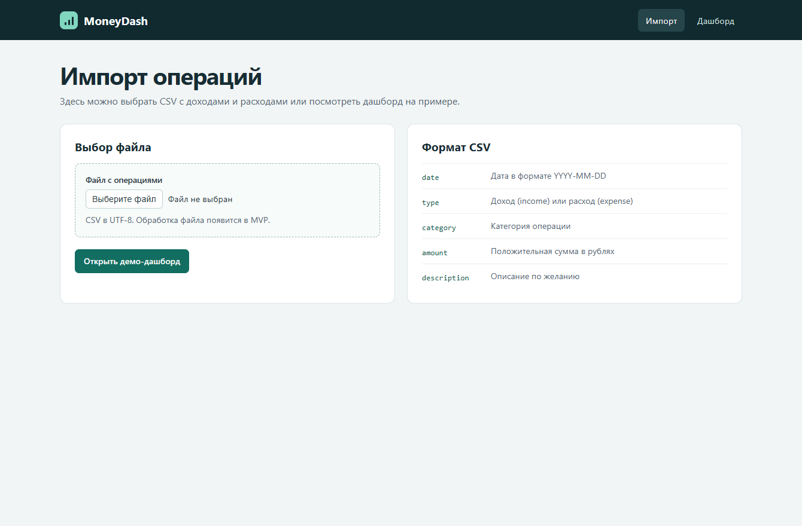
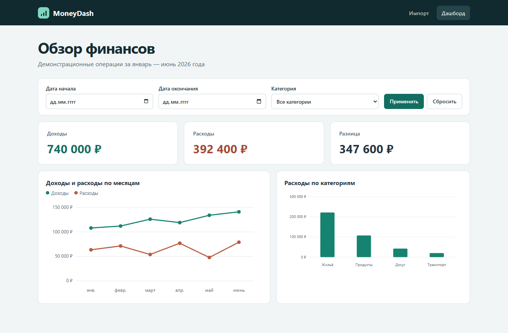

# MoneyDash

Веб-дашборд для анализа доходов и расходов. В каркасе можно выбрать CSV, открыть демонстрационный набор и отфильтровать сводку по датам и категории. Дашборд показывает итоговые суммы, их разницу и два графика. Импорт и агрегация пользовательского CSV на сервере запланированы для MVP.

`frontend` содержит приложение React и сервер Node.js. `ui-library` содержит общие компоненты `MetricCard` и `Chart`. Устройство проекта и сценарий первой версии описаны в [architecture.md](architecture.md) и [mvp.md](mvp.md).

## Запуск

### Первый запуск

Установите Node.js 24 LTS. npm 11 входит в официальный установщик. [Загрузки Node.js 24 LTS](https://nodejs.org/en/download/archive/v24.22.3)

Откройте новый терминал и проверьте версии. Эти две команды можно выполнять из любой папки.

```sh
node -v
npm -v
```

Перейдите в корень скачанного проекта `moneydash/`, где лежит `package-lock.json`. Из этой папки установите зависимости обоих пакетов.

```sh
npm ci
```

### Режим разработки

Запустите из корня `moneydash/`.

```sh
npm run dev
```

Команда собирает `ui-library` и запускает Vite. При изменениях во `frontend` страница обновляется автоматически. Откройте демо-дашборд по кнопке на странице импорта. [Приложение в режиме разработки](http://localhost:5173)

### Запуск готовой сборки

Выполните обе команды из корня `moneydash/`. Флаг `-w frontend` указывает npm, что команду `start` нужно выполнить в пакете `frontend`.

```sh
npm run build
npm run start -w frontend
```

Express отдаёт собранные файлы. Чтобы увидеть изменения в коде, остановите сервер, пересоберите проект и запустите его снова. [Собранное приложение](http://127.0.0.1:3000)

## Проверки

Запустите из корня `moneydash/`, чтобы проверить оба пакета.

```sh
npm run lint
npm test
npm run test:coverage
```

Для отчёта о покрытии только `frontend` выполните из того же корня.

```sh
npm run test:coverage -w frontend
```

## Скриншоты

### Импорт операций



### Демонстрационный дашборд


